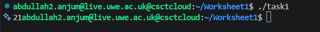
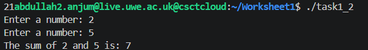
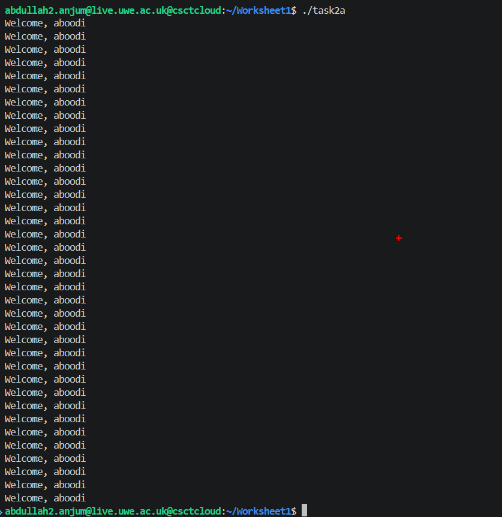
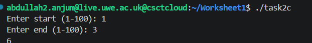
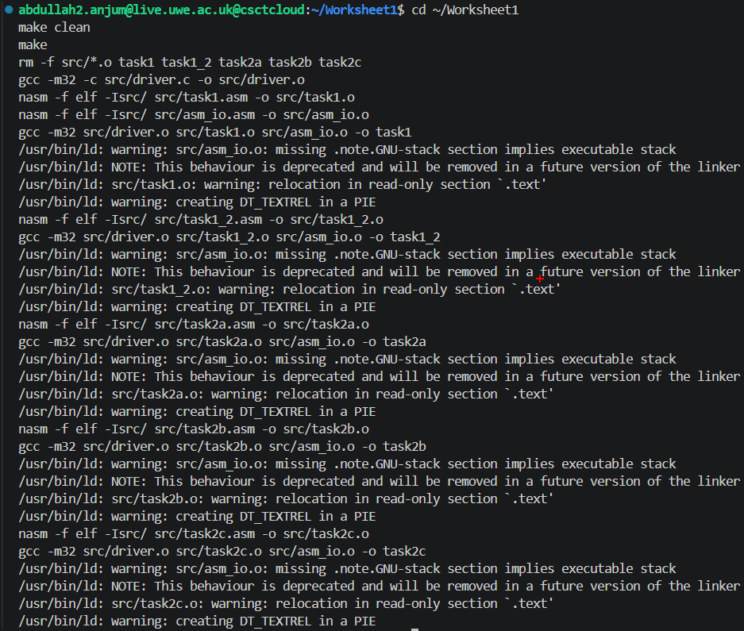

# Worksheet 1 — An Echo of Assembler

## Task 1
`task1.asm` adds two integers stored in global memory and prints the result using `print_int`.

​```nasm
mov eax, [integer1]
add eax, [integer2]
mov [result], eax
​```

Output of `./task1`:



`task1_2.asm` reads two integers from the user and prints their sum.

Output of `./task1_2`:



## Task 2
Three programs covering loops and conditionals. Note: the provided `asm_io` library has no 
`read_string` function, only `read_char`, so `task2a.asm` reads the user's name one character 
at a time into a buffer until a newline is seen.

**task2a** — asks for a name and a number (51–99), prints a welcome message that many times:
​```nasm
.read_name_loop:
    call    read_char
    cmp     eax, 10
    je      .name_done
    mov     [edi], al
    inc     edi
    jmp     .read_name_loop
​```


**task2b** — fills a 100-element array with 1–100 and sums it (result: 5050):


**task2c** — extends task2b to sum a user-entered range:


## Task 3
A root-level `Makefile` builds all five executables, with `all` as the default target. 
Since the Makefile runs from the repo root but the source files live in `src/`, 
`ASMFLAGS` includes `-Isrc/` so NASM can find `asm_io.inc` via `%include`.

Output of `make`:



## Task 4
This document.